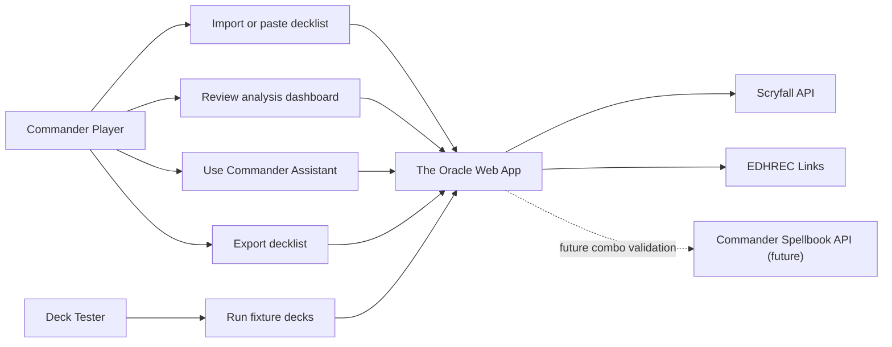

# The Oracle: A Magic: The Gathering Commander Deck Helper

## Team Members

| Member | Role |
| --- | --- |
| Brand | Project lead, product direction, deck testing, UI/UX review, and implementation decisions |
| Codex | AI-assisted development support for React implementation, heuristic design, documentation, and testing workflows |
| MTG playtesters / classmates | Optional reviewers who can test deck imports and evaluate whether the recommendations feel useful to Commander players |

Note: If this proposal is for a class submission, replace or supplement the table above with the official student team member names.

## Project Description

The Oracle is a web-based Magic: The Gathering Commander deck helper. The system lets a player paste or import a decklist, identify the commander, analyze the deck's card composition, check Commander legality, and receive Commander-focused advice about deck roles, archetypes, win conditions, possible additions, and possible cuts.

The goal is to build a practical tool for MTG players who already understand their deck but want a clearer second opinion. Instead of only showing generic charts, The Oracle will try to answer more player-centered questions:

- What kind of deck is this?
- How does this deck actually win?
- Are the ramp, card draw, removal, protection, and land counts healthy?
- Which cards look core to the deck's plan?
- Which cards might be flexible slots?
- What additions would fit the deck's actual archetype instead of only matching its colors?

This is interesting because Commander decks are highly contextual. Two decks with the same colors can play completely differently: one may be a token overrun deck, another a pillowfort deck, another a poison/proliferate control deck, and another a spellslinger combo deck. The Oracle explores how local card-data heuristics, public card APIs, and player-centered UI design can combine into a smarter deck review experience.

## Goals And Deliverables

The final project will deliver a React/Vite website with the following core features:

- Deck import from plain text and common decklist formats such as Moxfield, Archidekt, and MTGGoldfish-style text.
- Scryfall-powered card lookup, including support for split cards and double-faced cards.
- Commander legality and color identity checking.
- Deck analysis dashboard with total cards, lands, mana curve, card types, color identity, price estimate, and warnings.
- Commander Assistant that evaluates role packages such as lands, ramp, card draw, targeted removal, board wipes, and protection.
- Archetype detection for Commander playstyles such as Spellslinger/X-Spells, Lands/Landfall, Saga Enchantress, Aura Pillowfort, Poison/Toxic, Tokens/Go-Wide, Stax/Hatebears, Voltron, Aristocrats, and Reanimator.
- Win-plan detection that identifies how a deck closes games, such as Big Mana X-Spells, Poison Proliferate Clock, Token Overrun, Landfall Drain, Land Sacrifice, Aura Drain Fort, or Stax Combat Snowball.
- Recommendation panels for Add Next, Keep Core, and Possible Cuts.
- Decklist view with grouped card sections and card hover previews.
- Export tools for moving the decklist back into common deckbuilding formats.

## User Profiles

| User | Needs |
| --- | --- |
| Casual Commander player | Wants to paste a decklist and quickly see whether the deck has enough lands, ramp, card draw, and interaction. |
| Deck brewer | Wants help identifying the deck's plan and finding cards that fit the strategy without drifting into generic staples. |
| Playgroup optimizer | Wants to compare decks and tune power level, consistency, and win-condition clarity. |
| Newer MTG player | Wants plain-language explanations of why certain cards are core, flexible, or missing. |
| Tester / evaluator | Wants repeatable example decks to verify whether the system's labels and suggestions match real MTG strategy. |

## Usage Scenarios

1. A user pastes a Commander decklist into The Oracle.
2. The system detects or asks for the commander.
3. The system fetches card data from Scryfall.
4. The app checks Commander legality and color identity.
5. The user reviews the dashboard for high-level deck health.
6. The user opens Commander Assistant to see role counts, archetype read, win plan, suggested additions, core cards, and possible cuts.
7. The user hovers over cards to inspect images and oracle text.
8. The user exports the tuned list back to a deckbuilding site or plain text.

## Use-Case Diagram

## High-Level System Design

The system will be built as a browser-based single-page application.

### Frontend Application

The React/Vite frontend will provide the main user interface:

- Import screen for deck input and commander detection.
- Analysis tab for visual deck statistics.
- Commander Assistant tab for role counts, archetype detection, win-plan detection, and tuning suggestions.
- Decklist tab for grouped visual card browsing.
- Export tab for generating decklist output.

### Card Data Layer

The app will use Scryfall as the main card data source. Scryfall provides card names, oracle text, images, color identity, prices, legality data, mana costs, and type lines. This data powers legality checks, charts, card previews, and heuristic analysis.

### Heuristic Analysis Layer

Local analysis modules will classify cards and decks using card text, type lines, color identity, commander text, and known card packages. This layer will include:

- Deck parsing and lookup normalization.
- Commander legality logic.
- Role package classification.
- Archetype detection.
- Win-condition lane detection.
- Recommendation ranking.
- Possible-cut protection for core strategy cards.

### Knowledge And Testing Layer

The project will maintain an Obsidian-based design and research brain for notes, Acolyte fixture findings, known bugs, design decisions, and TODOs. Fixture decks will be used to compare The Oracle's output against real Commander primers and player expectations.

## Implementation Tasks

| Task | Description |
| --- | --- |
| Deck import and parsing | Support plain text and common exported formats, including sideboards and double-faced cards. |
| Scryfall integration | Fetch card data, images, oracle text, legality, prices, and color identity. |
| Analysis dashboard | Build visual summaries for card counts, types, mana curve, colors, warnings, and deck composition. |
| Commander legality | Check total card count, singleton rules, commander legality, and color identity. |
| Commander Assistant | Evaluate deck roles, archetypes, win plans, adds, keeps, and possible cuts. |
| UI/UX design | Make the app feel like a focused MTG deck workbench rather than a generic dashboard. |
| Fixture testing | Use real Commander decks and primers to refine archetype and recommendation accuracy. |
| Documentation | Maintain proposal, design notes, changelog, and testing notes. |

## Team Responsibilities

| Member | Responsibilities |
| --- | --- |
| Brand | Define product goals, choose example decks, review UI/UX quality, test recommendations as an MTG player, and approve design direction. |
| Codex | Implement React components and analysis modules, write helper scripts, maintain documentation drafts, and help refine heuristics. |
| MTG testers / classmates | Provide feedback on whether labels, suggestions, and possible cuts are accurate and useful. |

## Milestones

### Milestone 1: Functional Deck Analysis

Target outcome: A user can paste a decklist, identify the commander, fetch card data, and view a working deck analysis.

Measurable progress:

- Deck import works for plain text.
- Scryfall lookup succeeds for normal and double-faced cards.
- Commander card count and color identity checks work.
- Analysis dashboard shows card count, lands, mana curve, colors, and card types.

### Milestone 2: Commander Assistant And Archetype Refinement

Target outcome: The app gives Commander-specific strategic feedback that matches real deck intent.

Measurable progress:

- Commander Assistant shows role categories and health targets.
- Archetype detection works for several tested deck types.
- Win-plan detection can identify at least five distinct closing strategies.
- Add Next, Keep Core, and Possible Cuts panels use archetype-aware logic.
- Fixture decks are tested against expected labels and recommendations.

## Infrastructure

### Platforms

- Local development: Windows desktop environment.
- Runtime: Modern web browser.
- Deployment target: Static web hosting such as AWS Amplify, Netlify, Vercel, or GitHub Pages.

### Technologies

- React for UI components.
- Vite for local development and production builds.
- JavaScript / JSX for application logic.
- Scryfall API for card data and card images.
- EDHREC links for external Commander recommendation context.
- Commander Spellbook API as a possible future integration for combo validation.
- Obsidian for project notes, design memory, fixture findings, and planning.

### Open Issues / Help Needed

- More real Commander fixture decks are needed for under-tested archetypes such as Group Hug, Blink, Mill/Theft, Artifacts/Vehicles, Graveyard/Reanimator, and Combo.
- Recommendation quality depends on careful MTG knowledge; feedback from experienced Commander players will help avoid generic or misleading suggestions.
- Commander Spellbook integration needs design work so combo validation is sourced, explainable, and not overconfident.
- The app currently uses local heuristics. Future work could explore a backend service, saved deck history, user accounts, or a more formal testing harness.
- UI polish should continue across mobile and desktop so card previews, dense decklists, and recommendation panels remain readable.

## Expected Outcome

By the end of the project, The Oracle should be a usable Commander deck helper that can import a real decklist, explain what the deck appears to be doing, show how it wins, identify healthy or weak role packages, and recommend changes that feel relevant to the deck's actual plan. The main success measure is whether MTG players feel the tool understands their deck well enough to be worth using during brewing and tuning.
